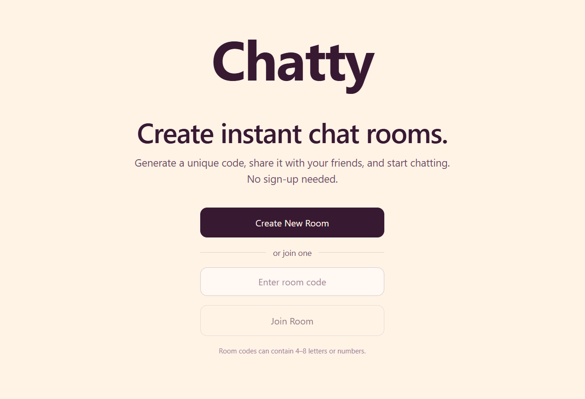

# Chatty 💬

Chatty is a real-time chat application that lets users create chat rooms, share a unique room code or invite link, and chat with friends. **No login or sign-up required.**

## Live Demo

🔗 Live Demo: https://chatty-live.vercel.app

## Features

- **Real-time messaging:** Send and receive messages instantly using Socket.IO.
- **Create and join rooms:** Start or join conversations using unique room codes.
- **Shareable invite links:** Invite friends to a room with a link.
- **Online members:** View the participants currently in a room.
- **Typing indicators:** See when other participants are typing.
- **Message history:** View recent messages and load older conversations.
- **Message search:** Find specific messages in a conversation.
- **Message deletion:** Delete your own messages.
- **Responsive interface:** Chat across desktop and mobile screens.
- **No authentication:** Start chatting without creating an account.

## How It Works

1. Open Chatty without signing up or logging in.
2. Create a chat room or join an existing room using its code.
3. Choose a display name and share the room code or invite link with friends.
4. Send messages and chat in real time.
5. View participants, typing indicators, and previous messages.

## Tech Stack

- React
- TypeScript
- Vite
- Tailwind CSS
- Node.js
- Express
- Socket.IO
- PostgreSQL
- Neon
- Vercel
- Render
